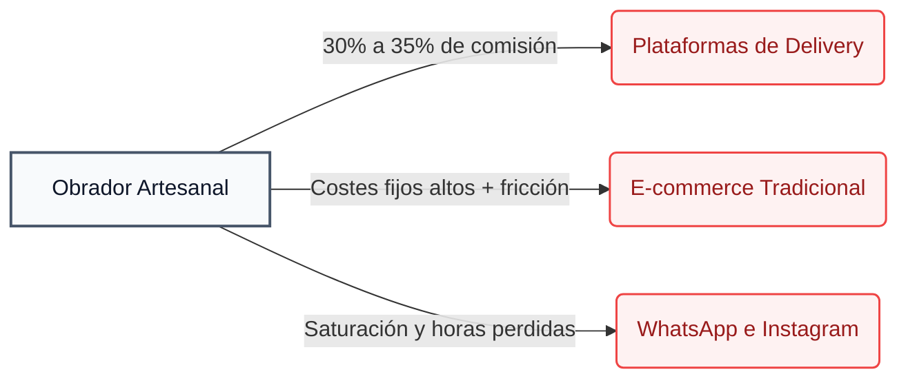
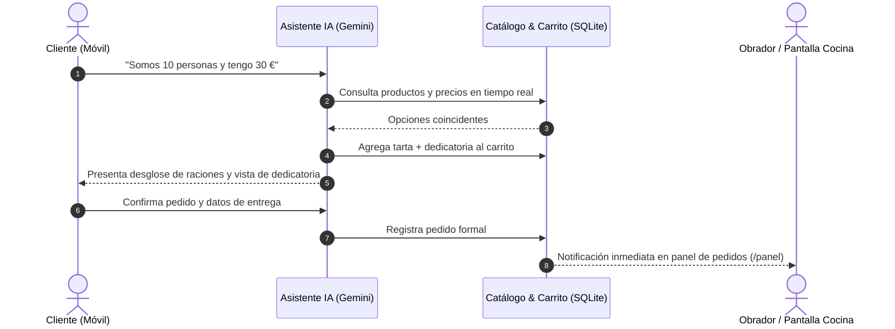

# Comercio Conversacional con IA para Pequeños Negocios y Repostería Artesanal

<p>
  <a href="https://github.com/gimenezsergio/Conversational-Commerce-Agentic-Commerce"></a>
  <a href="https://github.com/gimenezsergio/Conversational-Commerce-Agentic-Commerce"></a>
  <a href="https://github.com/gimenezsergio/Conversational-Commerce-Agentic-Commerce"></a>
  <a href="https://github.com/gimenezsergio/Conversational-Commerce-Agentic-Commerce"></a>
</p>

> [!NOTE]
> **Repositorio oficial del código y documentación:**  
> [https://github.com/gimenezsergio/Conversational-Commerce-Agentic-Commerce](https://github.com/gimenezsergio/Conversational-Commerce-Agentic-Commerce)

---

## 1. El Problema en el Mercado Español

En España, los pequeños obradores de repostería artesanal, pastelerías de encargo y negocios gastronómicos locales se encuentran atrapados entre tres barreras operativas:



* **Plataformas de delivery (Glovo, Uber Eats, Just Eat):**  
  Imponen comisiones de entre el **30% y el 35% por comanda**, destruyendo el margen comercial de productos artesanales elaborados con materia prima de calidad.
* **Plataformas tradicionales (Shopify, WooCommerce):**  
  Exigen cuotas fijas desde 36 €/mes más comisiones por transacción. Resultan rígidas para la repostería de encargo: un formulario convencional no sabe calcular raciones, sugerir combinaciones ni acordar dedicatorias.
* **Colapso en canales de mensajería:**  
  La toma de pedidos mediante mensajes directos insume horas diarias contestando consultas idénticas (*"¿para cuántas personas da esta tarta?", "¿qué precio tiene?", "¿puedes escribir un mensaje en chocolate?"*) en lugar de enfocarse en la producción.

---

## 2. La Solución: Comercio Agéntico Asistido por IA

El sistema combina un catálogo web optimizado para dispositivos móviles con un **asistente de Inteligencia Artificial agéntico** (respaldado por modelos de baja latencia de Google Gemini) capaz de interactuar directamente sobre la base de datos del negocio:



### Capacidades del Asistente

* **Cálculo automático de raciones:** Determina el tamaño de tarta adecuado según la cantidad de invitados y sugiere combinaciones (tarta principal + bocados dulces/salados).
* **Asesor de presupuesto en tiempo real:** Adapta el carrito al presupuesto máximo indicado por el cliente, sin ofrecer productos fuera del catálogo.
* **Personalización y dedicatorias:** Incorpora inscripciones personalizadas generando una vista previa de placa artesanal antes de cerrar el pedido.
* **Operación autónoma del carrito:** Agrega, modifica o elimina productos sin requerir que el usuario navegue formularios extensos.
* **Panel de obrador (`/panel`):** Panel en vivo para el pastelero con métricas, desglose de dedicatorias acordadas en el chat y gestión de estados (*Pendiente*, *En preparación*, *Listo*, *Entregado*).

---

## 3. Ventajas Competitivas Frente a Soluciones Estándar

| Dimensión | Plataformas de Delivery | Tiendas Online Tradicionales | Nuestra Plataforma |
| :--- | :--- | :--- | :--- |
| **Comisión por venta** | 30% – 35% | 1% – 2% + pasarela | **0%** |
| **Coste fijo de mantenimiento** | Nulo (pero con comisión abusiva) | Alto (desde 36 €/mes + apps) | **Mínimo** (infraestructura liviana) |
| **Medio de cobro preferido** | Tarjeta obligatoria | Pasarela de pago bancaria | **Bizum / Transferencia inmediata / Efectivo** |
| **Asesoramiento de compra** | Inexistente (catálogo plano) | Inexistente (formulario estático) | **Asistente activo 24/7** |
| **Canal de entrada** | App de terceros | Navegador complejo | **Enlace directo en bio de Instagram / WhatsApp** |

> [!TIP]
> **El factor Bizum en España:**  
> A diferencia de otros mercados donde se exigen pasarelas bancarias complejas, en España el pago directo por Bizum es la norma para pequeños comercios y profesionales independientes. El pedido se cierra con los datos acordados y se liquida al instante sin comisiones de intermediarios.

---

## 4. Guion de Demostración Práctica (3 Casos de Uso)

### Caso 1: Asesoramiento por raciones
```text
Usuario: "Somos 10 personas para un cumpleaños, ¿qué me recomiendas y cuántas raciones rinde?"
Asistente: Evalúa el catálogo, sugiere la tarta adecuada, detalla el gramaje por ración y ofrece añadir opciones complementarias.
```

### Caso 2: Ajuste a presupuesto y dedicatoria personalizada
```text
Usuario: "Tengo un presupuesto de 30 € y quiero una dedicatoria que diga 'Feliz Cumple Laura'"
Asistente: Filtra alternativas dentro del límite, renderiza visualmente la placa conmemorativa y carga el producto con notas al carrito.
```

### Caso 3: Cierre y recepción en obrador
```text
Usuario: Proporciona nombre, dirección o modalidad de recogida en tienda y forma de pago.
Sistema: Confirma la comanda y la traslada instantáneamente a /panel para su elaboración.
```

---

## 5. Plan de Validación Piloto en España

> [!IMPORTANT]
> **Estrategia Lean para validar el mercado sin riesgo financiero:**

1. **Selección de comercios de prueba:** Identificar entre **2 y 3 obradores artesanales** o profesionales de repostería creativa con presencia activa en Instagram.
2. **Período piloto (30 días):** Puesta en marcha sin coste de suscripción, configurando sus productos y precios locales en Euros (€).
3. **Métricas a validar:**
   * Reducción en minutos dedicados a la atención por chat.
   * Tasa de pedidos completados sin asistencia humana directa.
   * Valoración del cliente final sobre la fluidez del asistente.
4. **Modelo de monetización posterior:** Suscripción mensual fija y accesible (entre 19 € y 39 €/mes), muy por debajo de los costes de cualquier alternativa existente.
